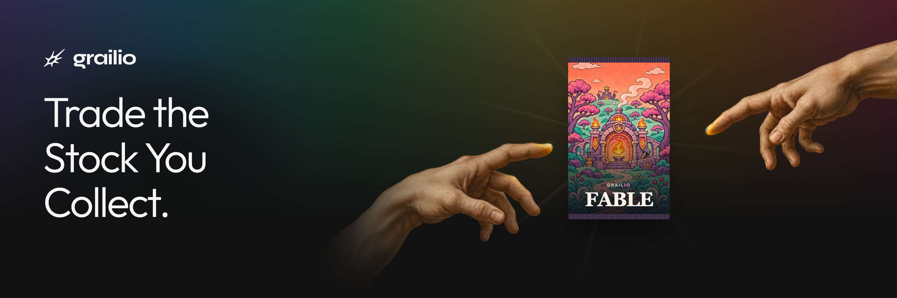

<p align="center">
  
</p>

<p align="center">
  <strong>Collectible cards that hold real tokenized stocks, on BNB Smart Chain.</strong><br>
  Open a $1 pack, reveal a card, and own the stock inside it.
</p>

<p align="center">
  <a href="https://www.grailio.xyz"><strong>Open the app</strong></a> ·
  <a href="https://testnet.grailio.xyz">Testnet</a> ·
  <a href="docs/ABOUT.md">About</a> ·
  <a href="docs/HOW-IT-IS-MADE.md">How it's made</a> ·
  <a href="#mainnet-addresses">Contracts</a>
</p>

<p align="center">
  
  
  
  
</p>

---

## What is Grailio?

Grailio is a card-collecting app where every card is backed by a **tokenized stock** (a bStock, issued by bStocks). Open a mystery pack and you get a card NFT with its own art and rarity, holding one of 15 stocks, from NVIDIA and Apple to index funds like SPY and QQQ. It's a collectible and something of real value at the same time.

| | |
| --- | --- |
| **Open packs** | Three editions ($1 Fable, $3 Saga, $5 Mythos), each with Low, Medium and High risk. |
| **Collect cards** | Common, Rare, Epic or Legendary, each holding a stock bought on chain when the pack opens. |
| **Stake or redeem** | Stake cards for USDT rewards, or redeem a card for the stock inside it. |
| **Trade** | Buy and sell cards on the marketplace (BNB or USDT), or swap the stocks directly at the best BSC DEX route. |
| **Vote and chat** | Every pack earns a DAO point. Holders of a stock get their own encrypted chat room. |
| **Gift** | Send a pack with a gift code; the recipient gets a little BNB for gas. |

There is no Grailio token: DAO votes use non-transferable points, and payments are in USDT.

> **Status:** live on BNB Smart Chain mainnet (contracts in [`deployments/56.json`](deployments/56.json)). All Low tiers are on sale, plus Fable Medium and High, Saga Medium and Mythos Medium; Saga High and Mythos High switch on as the pack pool grows. Swaps on `/trade` are real: KyberSwap routes them and your wallet signs.

## Quick start

Requires Node.js 20.9 or newer (and [Foundry](https://book.getfoundry.sh/) for the contracts).

```bash
git clone https://github.com/ptkakaeitoe/grailio-mainnet.git
cd grailio-mainnet
cp .env.example .env.local     # fill in the values (see Environment)
npm install
npm run dev -- -p 3300         # any free port; the testnet app uses 3200
```

Open <http://localhost:3300>. Without a Privy app ID, local development falls back to a browser wallet, and **demo mode** lets you try everything with simulated balances.

| Check | Command |
| --- | --- |
| Type check | `npx tsc --noEmit` |
| Lint | `npm run lint` |
| Unit tests | `node --test tests/*.mjs` |
| Production build | `npm run build` |
| Contract tests | `cd contracts && ./install-libs.sh && forge test` |

> This Next.js version has breaking changes from older releases. Read [`AGENTS.md`](AGENTS.md) and `node_modules/next/dist/docs/` before changing code.

## Project structure

```
app/            Routes (App Router) and API handlers, plus globals.css
components/     UI: pages' workspaces, dialogs, the hero art, shared styles (clean-ui.tsx)
lib/            Chain config, contract ABIs and addresses, prices, swaps, hooks
contracts/      Foundry project: the Collect* contracts, Atlas adapter, deploy scripts, tests
deployments/    Deployed addresses per chain (56.json)
public/         Card and pack art, stock logos, brand marks
tests/          Node test runner suites for the app logic
brand/          Logo and cover images (and their HTML sources in brand/src)
docs/           ABOUT.md (what it is) and HOW-IT-IS-MADE.md (how it works)
```

## Pages

| Route | What |
| --- | --- |
| `/` | The landing page: what Grailio is, and the ways in |
| `/packs` | Buy and open packs (three editions, three risk levels) |
| `/trade` | Swap tokenized stocks for USDT, USDC or BNB via KyberSwap |
| `/marketplace` | Buy and sell cards, priced in BNB or USDT, with a stock filter |
| `/collection` | Your cards (stake, redeem, view) and unopened packs |
| `/gift` | Claim a gift code; see and cancel gifts you sent |
| `/profile`, `/@handle` | Username, picture, bio, socials, ID card and holdings |
| `/dao` | Proposals and votes with collector points (1 per pack bought) |
| `/community` | An open lounge plus an encrypted room per stock for its card holders |
| `/treasury` | Owner: pack pool, what's owed, withdraw, pause |
| `/info` | Field guide and contract table |
| `/v2` | A minimal black-and-white test UI over the same code |

## How it works

### Packs

Every pack earns **1 DAO point**, whatever its price. Each card holds one tokenized stock from **its edition's basket** (`baskets` in `contracts/script/stocks.mainnet.json`):

| Edition | Price | Basket | Tier IDs (Low / Medium / High) |
| --- | --- | --- | --- |
| Fable | $1 | NVDA, AAPL, TSLA, GOOGL, AMZN | 0 / 1 / 2 |
| Saga | $3 | SPY, QQQ, BABA, NFLX, EWJ | 3 / 4 / 5 |
| Mythos | $5 | SPCX, ANT, SKHY, EWY, EWT | 6 / 7 / 8 |

Odds and card values per $1 of price (Saga ×3, Mythos ×5), as set in `contracts/script/MainnetConfig.sol`:

| Risk | Common | Rare | Epic | Legendary | Average value |
| --- | --- | --- | --- | --- | --- |
| Low | 50% · $0.95 | 25% · $0.95 | 20% · $0.95 | 5% · $0.95 | $0.95 (5% edge) |
| Medium | 50% · $0.46 | 25% · $0.80 | 20% · $1.40 | 5% · $4.00 | $0.91 (9% edge) |
| High | 60% · $0.20 | 25% · $0.60 | 12% · $2.80 | 3% · $10.13 | $0.91 (9% edge) |

In a Low pack every card holds the same 95% of the price; rarity only sets its staking multiplier. Tiers are switched on and off with `setTierActive`. Gas is paid in BNB.

<details>
<summary><strong>Where the money goes</strong></summary>

<br>

Pack payments go into the pack contract's USDT pool. When a pack opens:

1. The block hash rolls a rarity and picks a stock uniformly from the tier's basket (active assets only).
2. The card's value is swapped from USDT into that bStock on PancakeSwap v3 (routes in `stocks.mainnet.json`) and locked in the card.
3. The swap must return at least the Atlas fair amount (read through that stock's `AtlasFeedAdapter`, a Chainlink-style interface) minus a 3% slippage limit.
4. If the Atlas price is older than 6 hours, or the swap would come up short, the card is minted holding its value in USDT, and anyone can `fill` it later.

The difference between the price and the card value is profit, which `distribute()` shares between staking and the DAO. Staking rewards are paid in USDT. The owner can only withdraw USDT above what unopened packs and unfilled cards could still pay out, and never tokens locked in cards. Odds live in `PACK_TIERS` (`lib/contracts.ts`) and `contracts/script/MainnetConfig.sol`.

</details>

### Prices

All in `lib/quotes.ts`.

- **Stocks:** read on chain from Atlas Oracle's MultiFeed (`fetch(feedId)`, `lib/atlas.ts`), cached for 30 seconds. 24h change and charts come from Yahoo Finance, ending on the Atlas price. The pack contract uses the same Atlas feeds.
- **BNB:** read on chain from the PancakeSwap v3 WBNB/USDC pool, in the same 30-second cache; 24h change from GeckoTerminal for that pool. USDC is treated as $1.
- **Adding a stock:** one line in `lib/stock-assets.ts` (asset ID, ticker, name, token address, decimals, Atlas feed ID, accent), and a logo at `public/logos/{TICKER}B.png`.

### Swaps

The tradable tokens are the 15 stocks in `lib/stock-assets.ts`, paid or received in USDT, USDC or BNB (`SWAP_KEYS` in `lib/tokens.ts`). KyberSwap routes each trade across BSC DEXes (`lib/kyber.ts`):

- `GET /api/swap/quote` returns the route; `POST /api/swap/build` returns calldata, with slippage capped at 5%.
- The user's wallet signs; the server never signs or sends.
- Every swap must target KyberSwap's router, checked on the server and in the browser.
- Grailio takes a 0.5% fee inside each swap (`lib/swap-fee.ts`). When USDT is on either side, half goes to staking and half to the treasury wallet; otherwise all of it goes to the treasury.

### Beta gate

The beta gate is **off** (`BETA_GATE_ON = false` in `lib/beta-gate.ts`): anyone can browse, try the demo, connect a wallet, swap and chat. To bring it back, set it to `true` and fill `BETA_ACCESS_CODES` and `BETA_COOKIE_SECRET`. The server then checks the code and sets a signed httpOnly cookie for 90 days. It's a UI gate only: contracts on a public chain can always be called directly.

## Environment

Names are in [`.env.example`](.env.example); you fill in the values. Never commit `.env.local`.

| Variable | Needed for | Required? |
| --- | --- | --- |
| `NEXT_PUBLIC_PRIVY_APP_ID` | Sign-in (Privy). Enable BNB Smart Chain and add your domain in the Privy dashboard | Yes in production; local dev falls back to a browser wallet |
| `NEXT_PUBLIC_BSC_RPC_URL` | Your own RPC instead of `bsc-dataseed.bnbchain.org` | Optional, recommended |
| `NEXT_PUBLIC_WALLETCONNECT_PROJECT_ID` | Mobile wallets via WalletConnect | Optional |
| `RELAYER_KEY` | Free chat posts and gift gas top-ups (a dedicated wallet with a little BNB) | Optional |
| `UPSTASH_REDIS_REST_URL`, `UPSTASH_REDIS_REST_TOKEN` | Shared relay limits and the contract-log cache (or Vercel KV) | Required in production if `RELAYER_KEY` is set |
| `NEXT_PUBLIC_SITE_URL` | The deployed origin, for link previews | Optional |
| `NEXT_PUBLIC_TESTNET_URL` | The testnet app, linked from the Testnet / Mainnet beta switch in the footer (shown as unavailable when unset) | Optional |
| `BETA_ACCESS_CODES`, `BETA_COOKIE_SECRET` | The beta gate, only if you turn it back on | No |
| `ETHERSCAN_API_KEY` | Only `contracts/script/verify.sh`. The app reads logs over public RPCs (`eth_getLogs`) | No |

## Mainnet addresses

**Grailio contracts**, deployed in block 135,895,169 on BNB Smart Chain ([`deployments/56.json`](deployments/56.json)), all verified on [Sourcify](https://sourcify.dev):

| Contract | Address |
| --- | --- |
| CollectPacks | [`0xfba2f95f7B4dC251e310830d16c14579FedA48cf`](https://bscscan.com/address/0xfba2f95f7B4dC251e310830d16c14579FedA48cf) |
| CollectMarket | [`0x1aF51f96ed7BEF036c805f668bCd10C6Fb114f8E`](https://bscscan.com/address/0x1aF51f96ed7BEF036c805f668bCd10C6Fb114f8E) |
| CollectPoints | [`0xB9e2f9ca9A3Cd685544a75e6fb6Ec335fb9797eE`](https://bscscan.com/address/0xB9e2f9ca9A3Cd685544a75e6fb6Ec335fb9797eE) |
| CollectDAO | [`0x0255552d14359EF44C6bc7b89b63655FcD071894`](https://bscscan.com/address/0x0255552d14359EF44C6bc7b89b63655FcD071894) |
| CollectStaking | [`0x3A6a51C0f6ac6283Ea720711Aba278A3AEA75B56`](https://bscscan.com/address/0x3A6a51C0f6ac6283Ea720711Aba278A3AEA75B56) |
| CollectChat | [`0xc7b63D7C7d8a235Ae4f5E3E0BdFaF652C8388B15`](https://bscscan.com/address/0xc7b63D7C7d8a235Ae4f5E3E0BdFaF652C8388B15) |
| CollectNames | [`0xf9D0186A8fDd9D0886F3794638Fb62311a037dAF`](https://bscscan.com/address/0xf9D0186A8fDd9D0886F3794638Fb62311a037dAF) |
| CollectProfiles | [`0x533C8191B7bd61C918768466B9e70e3A4C9ec650`](https://bscscan.com/address/0x533C8191B7bd61C918768466B9e70e3A4C9ec650) |
| AtlasFeedAdapter (one per stock) | `stockAssets.<ticker>.adapter` in `deployments/56.json` |

<details>
<summary><strong>Third-party contracts it uses</strong></summary>

<br>

All read on chain 56 on 2026-11-26 (`lib/tokens.ts`, `lib/atlas.ts`, `contracts/script/MainnetConfig.sol`, `contracts/script/StockConfig.sol`):

| What | Address |
| --- | --- |
| USDT (Binance-Peg, 18 decimals) | `0x55d398326f99059fF775485246999027B3197955` |
| USDC (Binance-Peg, 18 decimals) | `0x8AC76a51cc950d9822D68b83fE1Ad97B32Cd580d` |
| WBNB | `0xbb4CdB9CBd36B01bD1cBaEBF2De08d9173bc095c` |
| Atlas Oracle MultiFeed (stock prices) | `0xEAcE519ebB14fB8404fA6DdD23C3b34abaDE44aa` |
| PancakeSwap v3 SmartRouter (card fills) | `0x13f4EA83D0bd40E75C8222255bc855a974568Dd4` |
| KyberSwap MetaAggregationRouterV2 (swaps may only go here) | `0x6131B5fae19EA4f9D964eAc0408E4408b66337b5` |
| BNB price pool (PancakeSwap v3 WBNB/USDC 0.01%) | `0xf2688Fb5B81049DFB7703aDa5e770543770612C4` |
| bStock tokens (15) | `stockAssets.<ticker>.token` in `deployments/56.json` (also `contracts/script/stocks.mainnet.json`) |

The 15 bStocks, by asset ID: NVDA, AAPL, TSLA, GOOGL, AMZN (Fable); SPY, QQQ, BABA, NFLX, EWJ (Saga); SPCX, ANT, SKHY, EWY, EWT (Mythos). The swap-fee treasury wallet is `SWAP_FEE_TREASURY` in `lib/swap-fee.ts`.

</details>

## Brand

The logo and cover live in [`brand/`](brand), rendered at 2× from the HTML in [`brand/src`](brand/src):

| File | Size | Use |
| --- | --- | --- |
| `grailio-cover-3000x1000.png` | 3000 × 1000 | Social header and this README |
| `grailio-icon-2048.png` | 2048 × 2048 | Profile picture or app icon |
| `grailio-logo-3200x1000.png` | 3200 × 1000 | Mark and wordmark on dark |
| `grailio-logo-transparent-3200x1000.png` | 3200 × 1000 | Mark and wordmark, white on transparent |

The look: a near-black `#111` canvas, light `#f5f5f5` ink, a faint rainbow glow across the top, gold for light and rarity, Outfit (light) for headlines, DM Sans for text, Geist Mono for numbers, and Syne for the wordmark.

## For the owner

What's left that only the owner can do (pool funding, tier switches, Privy and Google sign-in setup, optional BscScan badge) is tracked in [`TODO-OWNER.md`](TODO-OWNER.md).

## Stack

Next.js 16 (App Router) · React 19 · wagmi 2 · viem 2 · Privy · Tailwind CSS 4 · Foundry · OpenZeppelin 5.4
